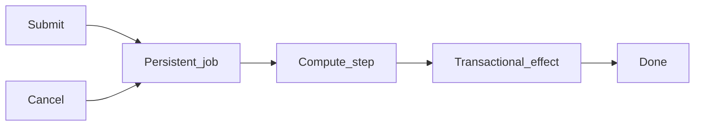

# Durable Agent Runner

Checkpointed jobs with restart-safe local side effects.

[](https://github.com/danielpdev/durable-agent-runner/actions/workflows/ci.yml)

**Role focus:** Agent Infrastructure / Backend. **Status:** working local portfolio implementation, with synthetic data.

## The engineering decision

A job advances one durable step per transaction. The demonstrated business effect is stored in the same database transaction as its checkpoint, so a restart cannot duplicate that local effect.



## Run locally

Requirements: Python 3.12, [uv](https://docs.astral.sh/uv/getting-started/installation/) and Make.

```bash
git clone https://github.com/danielpdev/durable-agent-runner.git
cd durable-agent-runner
make setup
make demo
make test
make eval
```

`make demo` uses an isolated temporary database where relevant, so it is safe to repeat. `make eval` writes a timestamped report to `reports/evaluation-fixture.json`. Fixture mode is deterministic and does not represent model inference. There is no recurring hosting or API subscription cost.

`make serve` opens the local API on `http://127.0.0.1:8106/docs`.

[Watch the recorded demo](docs/demo.mp4) · [Reproduce the walkthrough](docs/DEMO.md)

## Verification and evidence

A child process exits after committing a checkpoint; a new runner resumes and produces one effect. Cancellation stops subsequent effects.

- [Evaluation report](reports/evaluation-fixture.json) — measured during an actual run; inspect the mode and dataset size.
- [Development and authorship](docs/DEVELOPMENT.md).
- [Romanian interview preparation](docs/INTERVIEW_RO.md).
- [Design notes](docs/DESIGN.md).
- [Demo walkthrough](docs/DEMO.md).

CI uses standard GitHub-hosted runners and deterministic tests without downloading LLM weights. The lockfiles record exact package versions. Local-model results, when present, live in `reports/evaluation-local.json`; hardware/model identities are in `reports/environment.json`.

## Limits and next iteration

Exactly-once behavior is limited to the demonstrated local database transaction. Remote tools require idempotency keys or an outbox. There is no distributed scheduler or worker lease in this small runner.

Next: Add worker leases, retry policy and a remote outbox adapter.

The local demonstration does not include production authentication, secret management or operational service guarantees. Bind it to localhost and use synthetic data. These projects demonstrate engineering decisions; they do not claim real customers, paid production deployments or guaranteed interviews.

## Project ownership

Implemented with Codex assistance for Daniel Popa. The owner should review the code, run it, make an independent change and rehearse the tradeoffs before presenting it at interview. That human understanding check is pending and cannot be verified automatically. See [development notes](docs/DEVELOPMENT.md).

MIT for original source; dependencies/models retain their own licenses. See [third-party notices](THIRD_PARTY.md).
